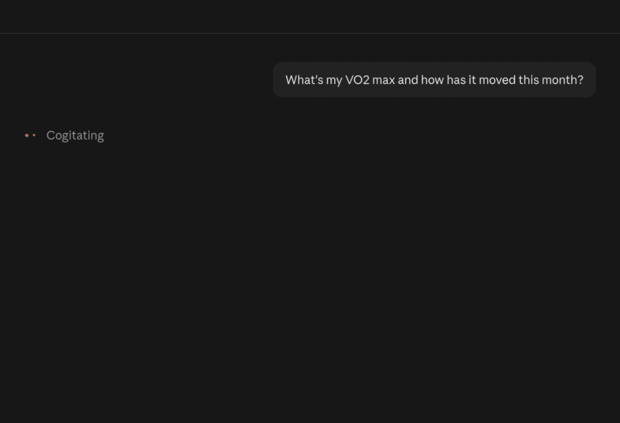
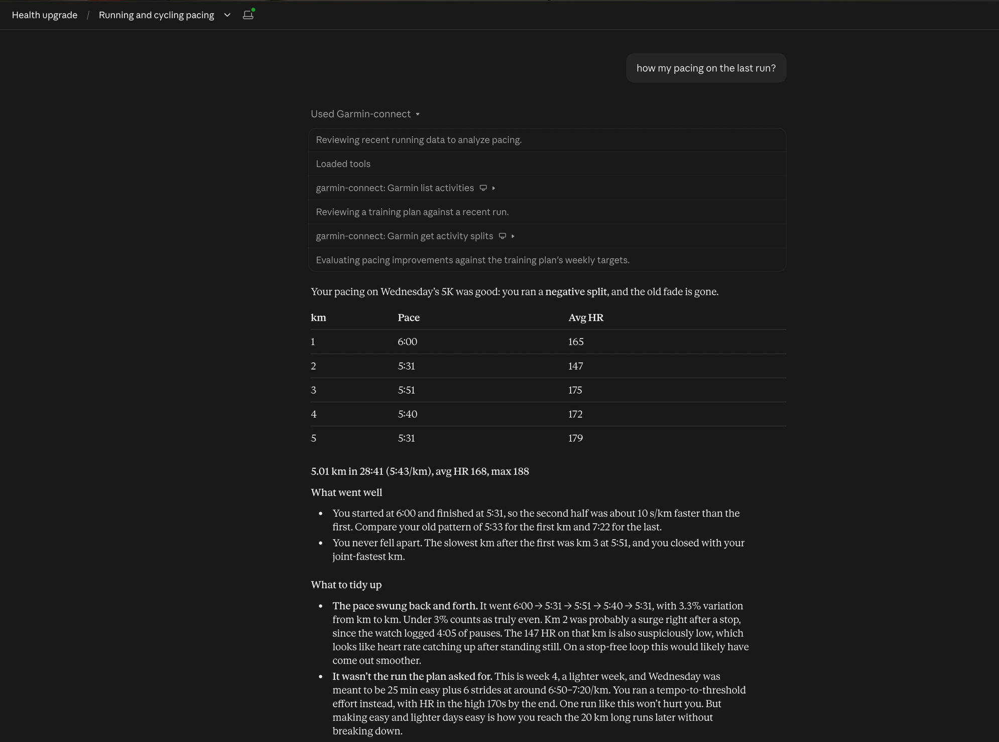
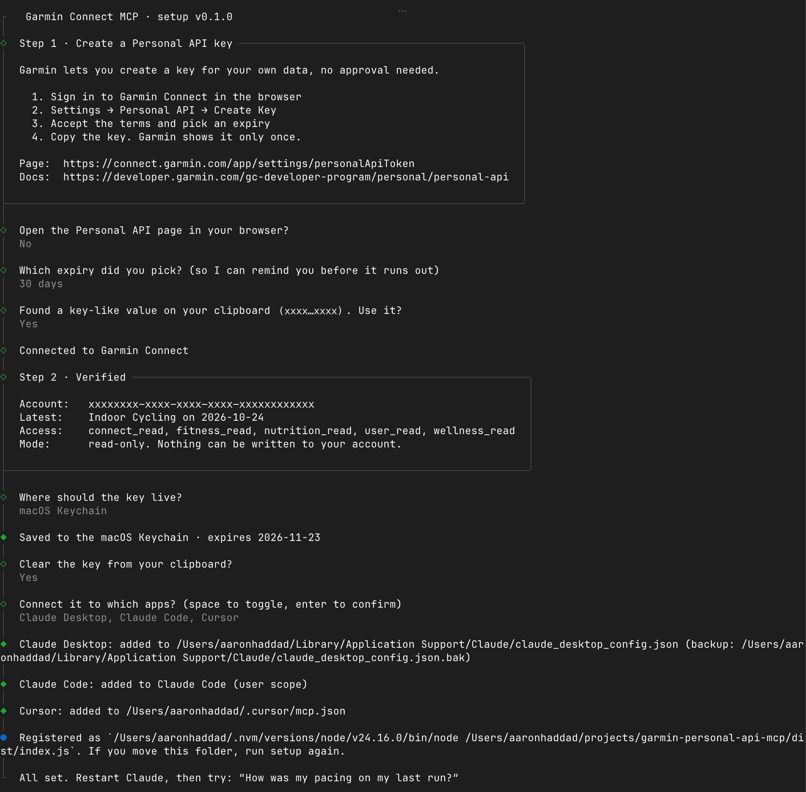

# garmin-personal-api-mcp

Talk to your own Garmin data from Claude (or any MCP client), using Garmin's **official Personal API**. No password, no scraping, no reverse-engineered login.



> "How was my pacing on yesterday's run?"
> "Compare my HRV and sleep this week with last week."
> "Has my weight moved since I started the bulk in September?"



It ships with an interactive setup wizard that walks you through creating the API key, checks it with Garmin, stores it in your macOS Keychain and wires it into Claude Desktop, Claude Code or Cursor.



## Claude Desktop: install as an extension

The simplest route on macOS and Windows. No terminal, no Node install.

1. Create a key: Garmin Connect → Settings → [Personal API](https://connect.garmin.com/app/settings/personalApiToken) → Create Key, and copy it.
2. Download `garmin-personal-api-mcp-<version>.mcpb` from the releases page and double-click it (or drag it into Claude Desktop → Settings → Extensions).
3. Claude Desktop installs it switched off until it has a key. Open Settings → Extensions → Personal Data for Garmin Connect, paste the key, click Save and switch it on.

When the key expires, open Settings → Extensions → Personal Data for Garmin Connect and paste a new one.

To build the extension yourself: `npm install && npm run pack:mcpb`.

## Quick start (Claude Code, Cursor, other MCP clients)

Requires Node.js 20.3 or later and a Garmin Connect account.

```bash
git clone https://github.com/aaronhaddad/garmin-connect-mcp-claude-connector.git
cd garmin-connect-mcp-claude-connector
npm install
npm run setup
```

Once the package is on npm, this becomes a one-liner:

```bash
npx garmin-personal-api-mcp setup
```

Restart Claude Desktop afterwards. That's it.

## What you can ask

| Tool | What it gives Claude |
|---|---|
| `garmin_list_activities` | Your activities with distance, time, pace and heart rate. Filter by date and type |
| `garmin_get_activity_splits` | Downloads the original `.FIT` file and computes **exact** km (or mile, or 400 m) splits, interpolated at each boundary with pauses removed, plus per-split HR, cadence and climb, device laps, and a pacing verdict (even, negative split, faded) |
| `garmin_get_performance_metrics` | Your **VO2 max** as Garmin Connect shows it, every VO2 max reading in a window, and per-activity aerobic/anaerobic training effect, recovery time and performance condition, decoded from the activity files |
| `garmin_get_activity` | Garmin's own summary for one activity |
| `garmin_get_day` | One call for a day: summary, sleep, HRV, Body Battery and activities |
| `garmin_get_daily_summaries` | Steps, calories, resting HR, stress and intensity minutes across a date range |
| `garmin_get_sleep`, `garmin_get_sleep_detail` | Nightly sleep summaries, or one night in full |
| `garmin_get_hrv` | Overnight HRV, baseline and status |
| `garmin_get_body_battery`, `garmin_get_stress`, `garmin_get_steps`, `garmin_get_hydration` | Daily wellness series |
| `garmin_get_weight`, `garmin_get_weight_goals` | Weigh-ins and body composition |
| `garmin_get_heart_rate`, `garmin_get_spo2`, `garmin_get_fitness_age`, `garmin_get_nutrition` | Single-day detail |
| `garmin_get_profile` | Units, profile and heart-rate zones |
| `garmin_download_activity_fit` | Save the original file locally, for Runalyze, Golden Cheetah and so on |
| `garmin_api_get` | Escape hatch for any other documented Personal API endpoint |

### Example prompts

| Tool | Try asking |
|---|---|
| `garmin_get_profile` | "What are my heart-rate zones?" |
| `garmin_list_activities` | "List my runs from the last two weeks." |
| `garmin_get_performance_metrics` | "What's my VO2 max, and how has it moved this month?" |
| `garmin_get_activity` | "What was the training effect of my last ride?" |
| `garmin_get_activity_splits` | "How was my pacing on yesterday's run? Did I fade?" |
| `garmin_download_activity_fit` | "Save the FIT file of my last run to ~/Downloads." |
| `garmin_get_day` | "How recovered am I today?" |
| `garmin_get_daily_summaries` | "How many intensity minutes did I get each day this week?" |
| `garmin_get_sleep` | "Compare my sleep this week with last week." |
| `garmin_get_sleep_detail` | "Break down last night's sleep stages." |
| `garmin_get_hrv` | "Is my HRV within my baseline this month?" |
| `garmin_get_body_battery` | "How did my Body Battery recharge overnight this week?" |
| `garmin_get_stress` | "Which day this week was most stressful?" |
| `garmin_get_steps` | "Did I hit my step goal every day this month?" |
| `garmin_get_hydration` | "How much water did I log yesterday?" |
| `garmin_get_weight` | "Has my weight moved since September?" |
| `garmin_get_weight_goals` | "What's my current weight goal?" |
| `garmin_get_wellness_activities` | "Show my breathwork sessions this month." |
| `garmin_get_heart_rate` | "What was my resting heart rate yesterday?" |
| `garmin_get_spo2` | "What was my Pulse Ox last night?" |
| `garmin_get_fitness_age` | "What's my fitness age?" |
| `garmin_get_nutrition` | "What did I log for food yesterday?" |
| `garmin_api_get` | "Get my menstrual cycle summary for this month." |

Dates accept `YYYY-MM-DD`, `today`, `yesterday` or `N days ago`. Long ranges are split into the chunk sizes Garmin accepts and merged for you.

## What the Personal API can't do

These limits are Garmin's, not this server's:

- **Read-only.** You can't push workouts, courses or training plans to your watch. Garmin keeps the Training and Courses APIs in its business tiers.
- **No server-side coaching metrics** such as training readiness, training status or race predictions. VO2 max, training effect and recovery time *are* available: Garmin's watches write them into each activity file, and `garmin_get_performance_metrics` decodes them. VO2 max and training effect match Garmin Connect; recovery time and performance condition come from undocumented fields and are approximate.
- **Your account only.** The key only reads the account that created it.

## Security

- The key is stored in the **macOS Keychain** by default. On other systems it goes in `~/.config/garmin/connect-personal-api-key` with `chmod 600`, the same place Garmin's official Python client looks, so both tools share it.
- The wizard reads the key through hidden input or straight from your clipboard (and offers to clear the clipboard afterwards). It never passes the key on a command line.
- The key is exchanged for a 24-hour bearer token, cached in `~/.config/garmin-personal-api-mcp/token.json` (0600) and refreshed an hour before it expires.
- Every call is a GET to `personal.connectapi.garmin.com`. The raw tool only accepts paths under the documented services.
- To revoke access: `npx garmin-personal-api-mcp logout`, then delete the key in Garmin Connect under Settings → Personal API.

Key lookup order: `$GARMIN_PERSONAL_API_KEY`, then the Keychain, then the key file. The Claude Desktop extension passes its key through `$GARMIN_PERSONAL_API_KEY`.

## Privacy

Nothing is collected. Data goes from Garmin to your computer to your MCP client and nowhere else. See [PRIVACY.md](PRIVACY.md).

## Commands

```
garmin-personal-api-mcp setup     Interactive setup: key + connect apps
garmin-personal-api-mcp status    Check the saved key still works, and when it expires
garmin-personal-api-mcp logout    Remove the saved key and cached token
garmin-personal-api-mcp           Run the MCP server on stdio (what your MCP client launches)
```

For scripts and dotfiles: `pbpaste | garmin-personal-api-mcp setup --key-stdin --storage keychain`.

### Manual client config

If you'd rather not let the wizard edit your config, add this yourself:

```json
{
  "mcpServers": {
    "garmin-connect": {
      "command": "node",
      "args": ["/absolute/path/to/garmin-personal-api-mcp/dist/index.js"]
    }
  }
}
```

Claude Code: `claude mcp add --scope user garmin-connect -- node /absolute/path/to/dist/index.js`

## Development

```bash
npm install
npm run check      # type-check, unit tests, and an end-to-end MCP smoke test against a fake Garmin API
npx @modelcontextprotocol/inspector node dist/index.js
```

Built on the MCP TypeScript SDK v2, Garmin's [FIT JavaScript SDK](https://github.com/garmin/fit-javascript-sdk) and [@clack/prompts](https://github.com/bombshell-dev/clack). Endpoint paths follow Garmin's Apache-2.0 [connect-personal-api-python](https://github.com/garmin/connect-personal-api-python) client.

## Disclaimer

This is an independent project, not made or endorsed by Garmin. It only uses Garmin's documented Personal API, and your use of that API is subject to Garmin's terms. "Garmin" and "Garmin Connect" are trademarks of Garmin Ltd.

## License

MIT
